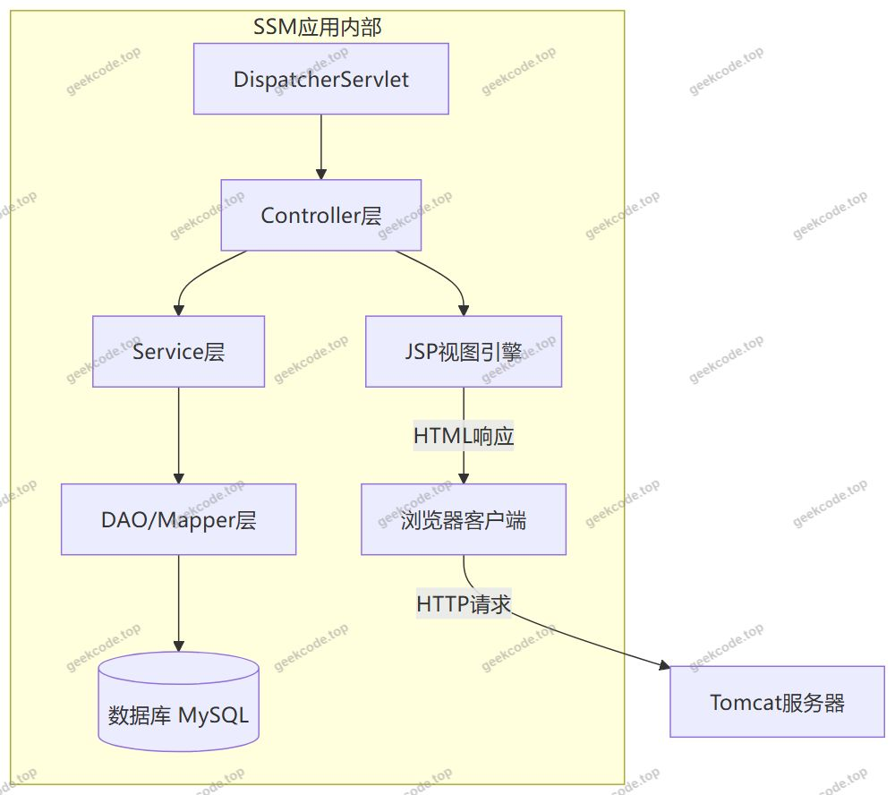
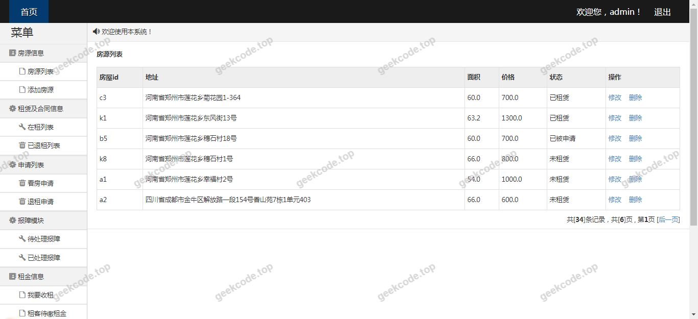
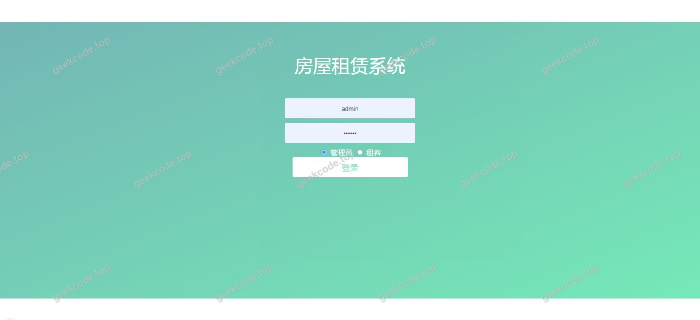
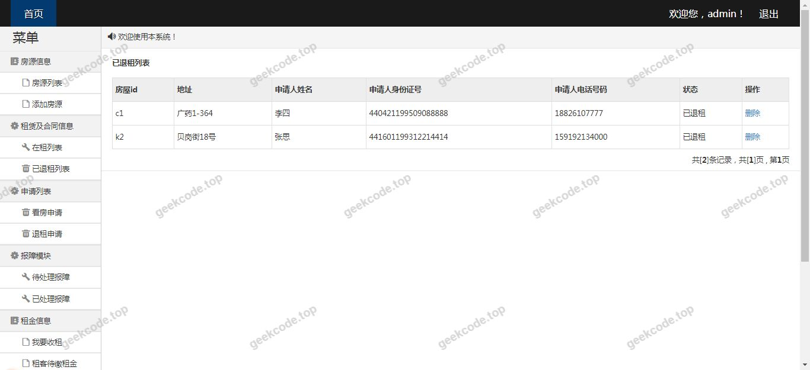
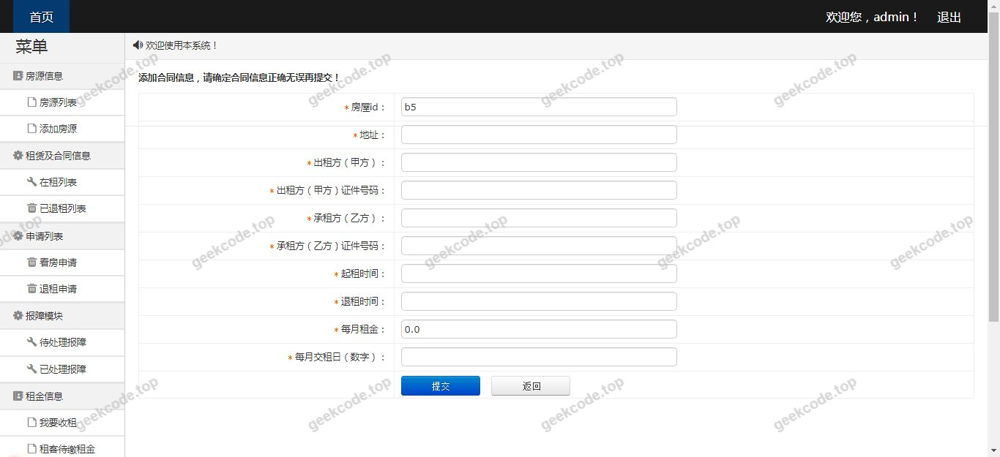
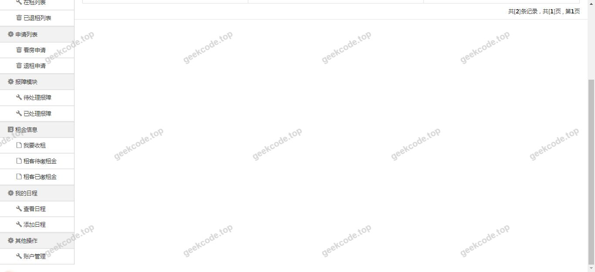
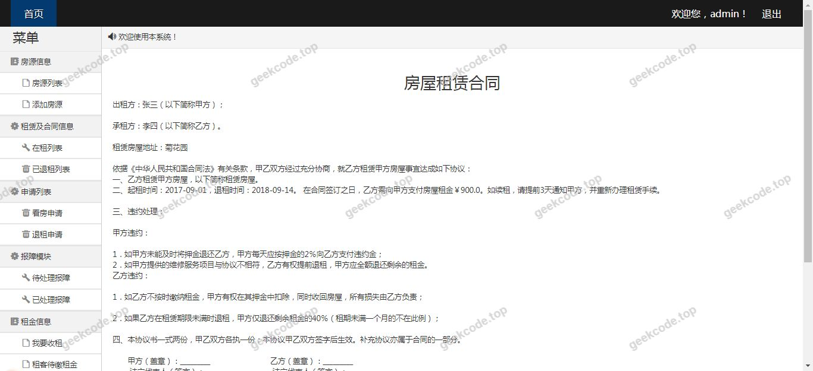

# java精品项目-基于ssm的房屋租赁系统

> 🎓 **计算机毕业设计 · java精品项目-基于ssm的房屋租赁系统**
>
> 本仓库只放**项目介绍 + 运行截图**（截图是站点带水印的原图，存在仓库 `images/` 里）。
>
> 👉 **完整可运行源码 / 数据库脚本 / 部署文档：[点我获取](https://geekcode.top/archives/java%E7%B2%BE%E5%93%81%E9%A1%B9%E7%9B%AE-%E5%9F%BA%E4%BA%8Essm%E7%9A%84%E6%88%BF%E5%B1%8B%E7%A7%9F%E8%B5%81%E7%B3%BB%E7%BB%9F?utm_source=github)**
>
> 💬 咨询微信：**ir9372**　|　🌐 更多项目：[极客代码 geekcode.top](https://geekcode.top/?utm_source=github)
>
> 📌 项目详情页：<https://geekcode.top/archives/java%E7%B2%BE%E5%93%81%E9%A1%B9%E7%9B%AE-%E5%9F%BA%E4%BA%8Essm%E7%9A%84%E6%88%BF%E5%B1%8B%E7%A7%9F%E8%B5%81%E7%B3%BB%E7%BB%9F?utm_source=github>

<table><td width="230" align="center"> <b>扫码加微信 ir9372</b></td><td valign="middle">📦 源码 = 项目介绍 + 全部运行截图 + 数据库 + 部署文档 👉 点上方任意截图，直接跳到 <b>极客代码 geekcode.top</b> 详情页</td></table>

---

<h1>java精品项目-基于ssm的房屋租赁系统</h1>
<h2>项目概述</h2>

本项目名为“基于SSM的房屋租赁系统”，是一个采用传统JSP技术栈构建的Web应用程序。该项目旨在通过数字化手段管理房屋租赁业务流程，核心目标是实现房源信息、租赁交易及相关数据的信息化处理。尽管项目名称中提及“Spring Boot”，但根据实际技术栈配置（SSM, JSP）及无前后端分离架构的特征，本系统实质上是基于Spring + Spring MVC + MyBatis（SSM）框架开发的单体应用，前端页面由JSP动态生成。适用场景为中小型房产中介或房东对房屋出租业务的日常管理与记录。由于提供的上下文显示无明确的前台导航菜单、后台路由及个人中心功能定义，且截图仅展示通用运行界面，具体业务模块细节需结合源码进一步确认，目前主要体现为一个基础的信息管理系统原型。

<h2>技术架构</h2>

本系统采用经典的Java EE分层架构设计，具体技术选型如下：

<ol>
<li><strong>后端框架</strong>：使用SSM组合框架。</li>
</ol>
<ul>
<li><strong>Spring</strong>：负责IoC容器管理和AOP切面编程，作为系统的核心控制中枢。</li>
<li><strong>Spring MVC</strong>：处理HTTP请求映射、参数绑定及视图解析，连接控制器与JSP页面。</li>
<li><strong>MyBatis</strong>：作为持久层框架，负责SQL语句的映射与数据库交互，提供灵活的ORM能力。</li>
</ul>
<ol start="2">
<li><strong>前端技术</strong>：采用JSP（Java Server Pages）技术。页面渲染在服务端完成，直接嵌入HTML标签和EL表达式/脚本片段，无需Node.js环境或前端构建工具。</li>
<li><strong>数据库设计</strong>：通常依赖关系型数据库（如MySQL），存储用户信息、房屋详情、租赁订单等结构化数据。</li>
<li><strong>架构特点</strong>：单体架构，前后端耦合度高。所有业务逻辑、数据访问和页面展示均在同一个Tomcat容器中运行。</li>
</ol>

<h2>功能模块</h2>

根据提供的上下文信息，本项目未明确列出具体的前台用户端和后台管理端的功能模块清单。截图仅展示了“系统运行界面”若干张，但未包含具体的菜单项、按钮功能或业务操作流程描述。因此，无法从现有信息中提取出确切的功能模块列表。

<ul>
<li><strong>前台用户端</strong>：根据现有信息无法确定具体功能。</li>
<li><strong>后台管理端</strong>：根据现有信息无法确定具体功能。</li>
</ul>

<em>(注：虽然项目名称为“房屋租赁系统”，理论上应包含房源发布、查询、租赁申请等功能，但鉴于指令要求严格基于提供的代码上下文和截图，且上下文中明确标注“无前台导航菜单”、“无后台路由”，故不在此处编造具体模块名称。)</em>

<h2>用户角色与权限</h2>

根据提供的上下文信息，项目中未定义具体的用户角色（如管理员、租客、房东等）及其对应的权限体系。同时，也未提供关于登录验证、角色鉴权或菜单可见性控制的代码片段或配置说明。

<ul>
<li><strong>角色定义</strong>：根据现有信息无法确定。</li>
<li><strong>权限分配</strong>：根据现有信息无法确定。</li>
</ul>
<h2>项目特色与创新点</h2>

基于现有的技术栈（SSM + JSP）和项目描述，该项目的特色主要体现在其经典性和稳定性上，而非前沿技术创新：

<ol>
<li><strong>成熟稳定的技术组合</strong>：SSM框架是Java Web开发中经过长期验证的经典组合，具有文档丰富、社区支持好、学习曲线平缓的特点，适合毕业设计阶段快速搭建原型。</li>
<li><strong>服务端渲染优势</strong>：采用JSP进行页面渲染，对于SEO友好（若涉及公开页面）且不需要复杂的前端工程化配置，部署简单，只需一个WAR包即可运行。</li>
<li><strong>轻量级架构</strong>：相比微服务或前后端分离架构，单体JSP应用在资源消耗和维护复杂度上相对较低，适合小规模应用场景。</li>
</ol>

<em>注意：由于缺乏具体的业务逻辑代码和创新性功能描述，无法提炼出针对“房屋租赁”领域的独特算法或交互创新。</em>

<h2>部署环境</h2>

运行本项目所需的软件环境如下：

<ol>
<li><strong>JDK版本</strong>：建议 JDK 1.8 或更高版本（SSM框架兼容性好）。</li>
<li><strong>Web容器</strong>：Apache Tomcat 7.x / 8.x / 9.x（需支持Servlet 3.0+规范）。</li>
<li><strong>数据库</strong>：MySQL 5.7 或 8.0（需创建对应的数据库实例及表结构）。</li>
<li><strong>构建工具</strong>：Maven 3.x（用于依赖管理和项目打包，假设项目为标准Maven结构）。</li>
<li><strong>IDE</strong>：IntelliJ IDEA 或 Eclipse（开发调试用）。</li>
<li><strong>其他</strong>：无需安装 Node.js、npm 或微信开发者工具，因为前端完全由JSP处理，不涉及现代前端构建流程。</li>
</ol>
<h2>五、技术特性</h2>
<ul>
<li>服务端模板渲染（JSP）</li>
</ul>
<h2>六、功能模块截图</h2>
<h3>前台用户端</h3>
<h4>系统运行界面1</h4>

<h4>系统运行界面2</h4>

<h4>系统运行界面3</h4>

<h4>系统运行界面4</h4>

<h4>系统运行界面5</h4>

<h4>系统运行界面6</h4>

---

## 获取完整源码

| 项目 | 说明 |
| --- | --- |
| 项目名 | java精品项目-基于ssm的房屋租赁系统 |
| 运行截图 | 本文 7 张（站点带水印原图，仓库 `images/` 目录） |
| 完整源码 | [https://geekcode.top/archives/java%E7%B2%BE%E5%93%81%E9%A1%B9%E7%9B%AE-%E5%9F%BA%E4%BA%8Essm%E7%9A%84%E6%88%BF%E5%B1%8B%E7%A7%9F%E8%B5%81%E7%B3%BB%E7%BB%9F?utm_source=github](https://geekcode.top/archives/java%E7%B2%BE%E5%93%81%E9%A1%B9%E7%9B%AE-%E5%9F%BA%E4%BA%8Essm%E7%9A%84%E6%88%BF%E5%B1%8B%E7%A7%9F%E8%B5%81%E7%B3%BB%E7%BB%9F?utm_source=github) |
| 咨询微信 | **ir9372**（备注：jingpin-yuanma） |
| 更多项目 | [极客代码 geekcode.top](https://geekcode.top/?utm_source=github) |

> 需要源码、部署、改配置、跑不起来等问题，加微信 ir9372 沟通，说明项目名即可。
